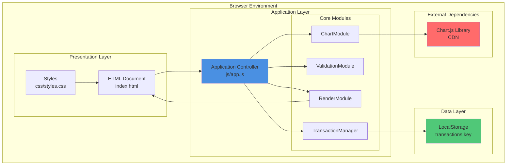
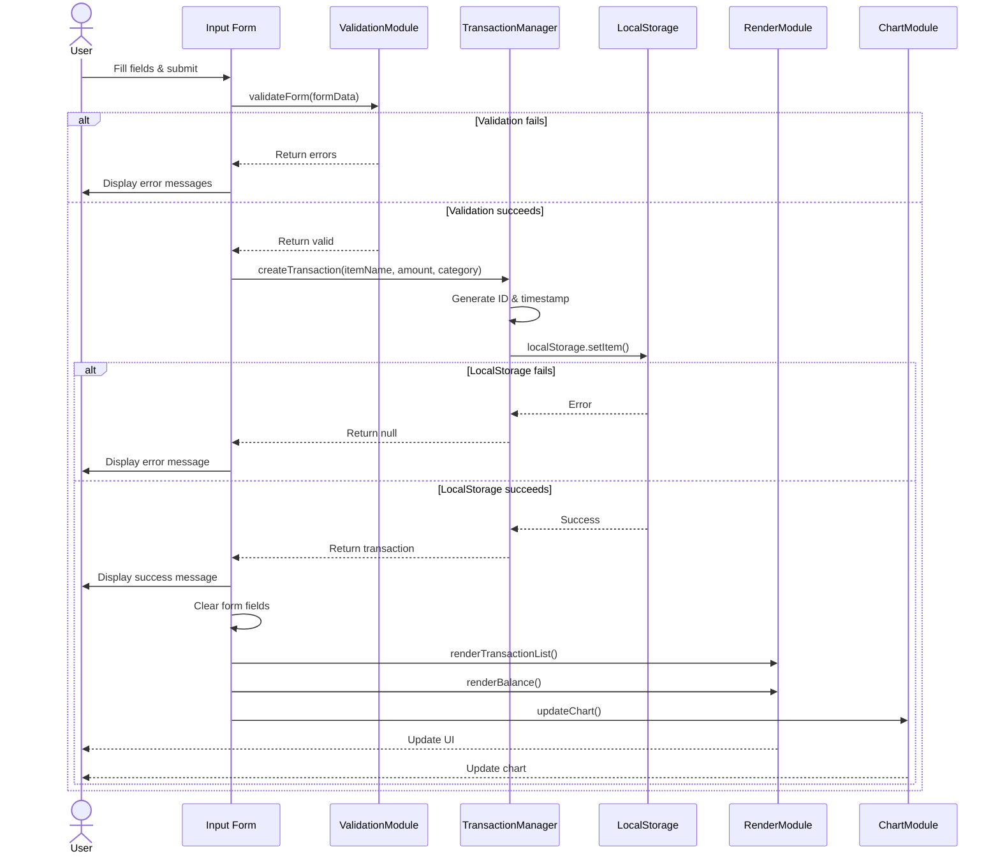
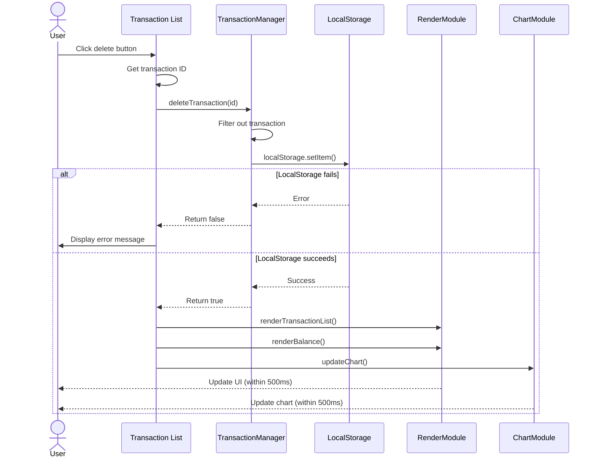
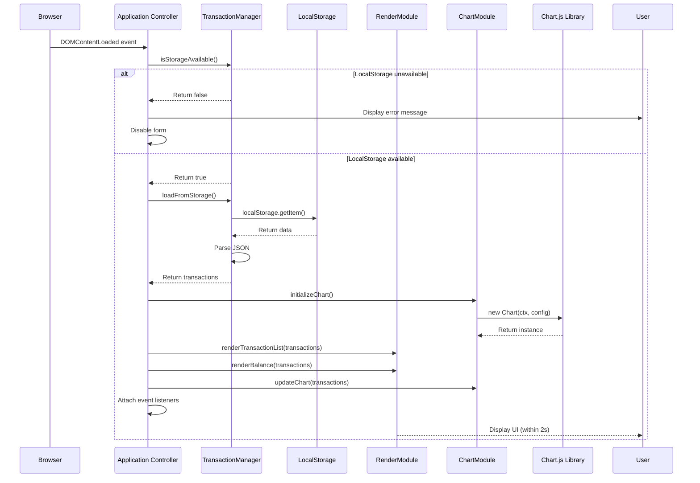

# Design Document: Expense & Budget Visualizer

## Overview

The Expense & Budget Visualizer is a client-side web application built with vanilla JavaScript, HTML, and CSS. The application provides a mobile-first, responsive interface for tracking daily expenses through transaction management and visual analytics. All data persists in the browser's LocalStorage, eliminating the need for backend infrastructure.

### Key Design Principles

1. **Client-Side Only**: All logic executes in the browser; no server communication required
2. **Mobile-First**: Design starts with mobile constraints and progressively enhances for larger screens
3. **Progressive Enhancement**: Core functionality works on all modern browsers; visual enhancements layer on top
4. **Separation of Concerns**: Clear boundaries between data layer, business logic, and presentation
5. **Performance-Focused**: Minimal dependencies, optimized DOM manipulation, and efficient rendering

### Technology Stack

- **HTML5**: Semantic markup with LocalStorage API support
- **CSS3**: Flexbox and Grid layouts with media queries for responsive design
- **Vanilla JavaScript (ES6+)**: No frameworks; modern language features (arrow functions, destructuring, modules pattern)
- **Chart.js**: External library for pie chart visualization ([chartjs.org](https://www.chartjs.org/))
- **LocalStorage API**: Browser-native persistent storage

## Architecture

### System Architecture Diagram



### Architectural Layers

#### 1. Presentation Layer
- **Responsibility**: Markup structure and visual styling
- **Components**: HTML elements, CSS rules
- **Interactions**: Receives user input events, displays rendered output

#### 2. Application Layer
- **Responsibility**: Business logic, state management, event handling
- **Components**: Application controller and core modules
- **Interactions**: Coordinates between presentation and data layers

#### 3. Data Layer
- **Responsibility**: Persistent storage and retrieval
- **Components**: LocalStorage wrapper functions
- **Interactions**: Serializes/deserializes transaction data

### Module Responsibilities

| Module | Responsibility | Key Functions |
|--------|---------------|---------------|
| **TransactionManager** | CRUD operations for transactions | `createTransaction()`, `deleteTransaction()`, `getAllTransactions()`, `loadFromStorage()`, `saveToStorage()` |
| **ValidationModule** | Input validation logic | `validateItemName()`, `validateAmount()`, `validateCategory()`, `validateForm()` |
| **RenderModule** | DOM manipulation and updates | `renderTransactionList()`, `renderBalance()`, `renderValidationError()`, `clearForm()` |
| **ChartModule** | Chart.js integration | `initializeChart()`, `updateChart()`, `calculateCategoryTotals()` |

## Components and Interfaces

### Component 1: Input Form

#### Purpose
Captures transaction details from the user with real-time validation feedback.

#### HTML Structure
```html
<form id="transaction-form" class="transaction-form">
  <div class="form-group">
    <label for="item-name">Item Name</label>
    <input 
      type="text" 
      id="item-name" 
      name="itemName" 
      maxlength="100"
      aria-required="true"
      aria-describedby="item-name-error"
    />
    <span id="item-name-error" class="error-message" role="alert"></span>
  </div>
  
  <div class="form-group">
    <label for="amount">Amount</label>
    <input 
      type="number" 
      id="amount" 
      name="amount" 
      step="0.01"
      min="0.01"
      max="999999.99"
      aria-required="true"
      aria-describedby="amount-error"
    />
    <span id="amount-error" class="error-message" role="alert"></span>
  </div>
  
  <div class="form-group">
    <label for="category">Category</label>
    <select 
      id="category" 
      name="category"
      aria-required="true"
      aria-describedby="category-error"
    >
      <option value="">-- Select Category --</option>
      <option value="Food">Food</option>
      <option value="Transport">Transport</option>
      <option value="Fun">Fun</option>
    </select>
    <span id="category-error" class="error-message" role="alert"></span>
  </div>
  
  <button type="submit" class="btn-primary">Add Transaction</button>
  <div id="form-success" class="success-message" role="status" aria-live="polite"></div>
</form>
```

#### Interface Definition
```javascript
// ValidationModule interface
const ValidationModule = {
  validateItemName(value) {
    // Returns: { valid: boolean, message: string }
  },
  
  validateAmount(value) {
    // Returns: { valid: boolean, message: string }
  },
  
  validateCategory(value) {
    // Returns: { valid: boolean, message: string }
  },
  
  validateForm(formData) {
    // Returns: { valid: boolean, errors: { field: message } }
  }
};
```

#### Validation Rules Implementation

```javascript
validateItemName(value) {
  if (!value || value.trim() === '') {
    return { valid: false, message: 'Item Name is required' };
  }
  
  if (value.trim() !== value || /^\s+$/.test(value)) {
    return { 
      valid: false, 
      message: 'Item Name must contain non-whitespace characters' 
    };
  }
  
  if (value.length > 100) {
    return { 
      valid: false, 
      message: 'Item Name must not exceed 100 characters' 
    };
  }
  
  return { valid: true, message: '' };
}

validateAmount(value) {
  if (value === null || value === undefined || value === '') {
    return { valid: false, message: 'Amount is required' };
  }
  
  const numValue = parseFloat(value);
  
  if (isNaN(numValue)) {
    return { valid: false, message: 'Amount must be a number' };
  }
  
  if (numValue < 0.01) {
    return { valid: false, message: 'Amount must be at least 0.01' };
  }
  
  if (numValue > 999999.99) {
    return { valid: false, message: 'Amount must not exceed 999999.99' };
  }
  
  return { valid: true, message: '' };
}

validateCategory(value) {
  const validCategories = ['Food', 'Transport', 'Fun'];
  
  if (!value || value.trim() === '') {
    return { valid: false, message: 'Category is required' };
  }
  
  if (!validCategories.includes(value)) {
    return { 
      valid: false, 
      message: 'Category must be Food, Transport, or Fun' 
    };
  }
  
  return { valid: true, message: '' };
}
```

### Component 2: Transaction List

#### Purpose
Displays all saved transactions in reverse chronological order with delete functionality.

#### HTML Structure
```html
<div class="transaction-list-container">
  <h2>Transaction History</h2>
  <div id="transaction-list" class="transaction-list" role="list">
    <!-- Dynamic content rendered here -->
    <!-- Empty state: -->
    <p class="empty-state">No transactions recorded</p>
    
    <!-- Or populated with transaction items: -->
    <!-- Transaction item template -->
    <div class="transaction-item" role="listitem" data-transaction-id="{{id}}">
      <div class="transaction-details">
        <span class="transaction-name">{{itemName}}</span>
        <span class="transaction-category badge-{{category}}">{{category}}</span>
      </div>
      <div class="transaction-actions">
        <span class="transaction-amount">${{amount}}</span>
        <button 
          class="btn-delete" 
          data-transaction-id="{{id}}"
          aria-label="Delete {{itemName}} transaction"
        >
          Delete
        </button>
      </div>
    </div>
  </div>
</div>
```

#### Interface Definition
```javascript
// RenderModule interface for Transaction List
const RenderModule = {
  renderTransactionList(transactions) {
    // transactions: Array<Transaction>
    // Renders all transactions or empty state
    // Attaches delete event listeners
  },
  
  removeTransactionFromDOM(transactionId) {
    // transactionId: string
    // Removes specific transaction element from DOM
  }
};
```

#### Rendering Logic
```javascript
renderTransactionList(transactions) {
  const listContainer = document.getElementById('transaction-list');
  
  // Empty state
  if (!transactions || transactions.length === 0) {
    listContainer.innerHTML = '<p class="empty-state">No transactions recorded</p>';
    return;
  }
  
  // Sort by timestamp descending (newest first)
  const sortedTransactions = [...transactions].sort((a, b) => 
    new Date(b.timestamp) - new Date(a.timestamp)
  );
  
  // Build HTML
  const html = sortedTransactions.map(transaction => `
    <div class="transaction-item" role="listitem" data-transaction-id="${transaction.id}">
      <div class="transaction-details">
        <span class="transaction-name">${escapeHtml(transaction.itemName)}</span>
        <span class="transaction-category badge-${transaction.category}">${transaction.category}</span>
      </div>
      <div class="transaction-actions">
        <span class="transaction-amount">$${transaction.amount.toFixed(2)}</span>
        <button 
          class="btn-delete" 
          data-transaction-id="${transaction.id}"
          aria-label="Delete ${escapeHtml(transaction.itemName)} transaction"
        >
          Delete
        </button>
      </div>
    </div>
  `).join('');
  
  listContainer.innerHTML = html;
  
  // Attach delete event listeners
  listContainer.querySelectorAll('.btn-delete').forEach(btn => {
    btn.addEventListener('click', handleDeleteTransaction);
  });
}
```

### Component 3: Balance Display

#### Purpose
Shows the total sum of all transaction amounts with automatic updates.

#### HTML Structure
```html
<div class="balance-display">
  <h2>Total Expenses</h2>
  <div id="balance-amount" class="balance-amount" aria-live="polite">
    $0.00
  </div>
</div>
```

#### Interface Definition
```javascript
// RenderModule interface for Balance
const RenderModule = {
  renderBalance(transactions) {
    // transactions: Array<Transaction>
    // Calculates sum and updates display
  },
  
  calculateTotalBalance(transactions) {
    // transactions: Array<Transaction>
    // Returns: number (sum of all amounts)
  }
};
```

#### Calculation Logic
```javascript
calculateTotalBalance(transactions) {
  if (!transactions || transactions.length === 0) {
    return 0.00;
  }
  
  // Sum all amounts, ensuring precision
  const total = transactions.reduce((sum, transaction) => {
    const amount = parseFloat(transaction.amount);
    // Only include amounts in valid range
    if (amount >= 0.01 && amount <= 999999999.99) {
      return sum + amount;
    }
    return sum;
  }, 0);
  
  // Round to 2 decimal places
  return Math.round(total * 100) / 100;
}

renderBalance(transactions) {
  const balanceElement = document.getElementById('balance-amount');
  const total = this.calculateTotalBalance(transactions);
  
  // Format with 2 decimal places
  if (total > 999999999.99) {
    balanceElement.textContent = total.toExponential(2);
  } else {
    balanceElement.textContent = `$${total.toFixed(2)}`;
  }
}
```

### Component 4: Chart Component

#### Purpose
Visualizes expense distribution by category using an interactive pie chart.

#### HTML Structure
```html
<div class="chart-container">
  <h2>Expenses by Category</h2>
  <div id="chart-wrapper">
    <canvas id="expense-chart" aria-label="Pie chart showing expense distribution by category"></canvas>
    <p id="chart-empty-state" class="chart-empty-state" style="display: none;">
      No expense data available
    </p>
  </div>
</div>
```

#### Interface Definition
```javascript
// ChartModule interface
const ChartModule = {
  chartInstance: null,
  
  initializeChart() {
    // Initializes Chart.js instance
    // Called once on page load
  },
  
  updateChart(transactions) {
    // transactions: Array<Transaction>
    // Recalculates category totals and updates chart
  },
  
  calculateCategoryTotals(transactions) {
    // transactions: Array<Transaction>
    // Returns: { category: total } object
  },
  
  destroyChart() {
    // Cleans up Chart.js instance
  }
};
```

#### Chart.js Integration
```javascript
initializeChart() {
  const ctx = document.getElementById('expense-chart').getContext('2d');
  
  this.chartInstance = new Chart(ctx, {
    type: 'pie',
    data: {
      labels: [],
      datasets: [{
        data: [],
        backgroundColor: [
          '#FF6384',  // Food - Red
          '#36A2EB',  // Transport - Blue
          '#FFCE56'   // Fun - Yellow
        ],
        borderWidth: 2,
        borderColor: '#ffffff'
      }]
    },
    options: {
      responsive: true,
      maintainAspectRatio: true,
      plugins: {
        legend: {
          position: 'bottom',
          labels: {
            padding: 15,
            font: {
              size: 14
            }
          }
        },
        tooltip: {
          callbacks: {
            label: function(context) {
              const label = context.label || '';
              const value = context.parsed || 0;
              const total = context.dataset.data.reduce((a, b) => a + b, 0);
              const percentage = ((value / total) * 100).toFixed(1);
              return `${label}: $${value.toFixed(2)} (${percentage}%)`;
            }
          }
        }
      }
    }
  });
}

calculateCategoryTotals(transactions) {
  const totals = { Food: 0, Transport: 0, Fun: 0 };
  
  transactions.forEach(transaction => {
    const amount = parseFloat(transaction.amount);
    
    // Only include positive amounts in valid range
    if (amount > 0 && amount <= 999999999.99) {
      const category = transaction.category;
      
      if (totals.hasOwnProperty(category)) {
        totals[category] += amount;
      } else {
        // Handle duplicate or custom categories by aggregation
        if (!totals[category]) {
          totals[category] = 0;
        }
        totals[category] += amount;
      }
    }
  });
  
  return totals;
}

updateChart(transactions) {
  const emptyState = document.getElementById('chart-empty-state');
  const canvas = document.getElementById('expense-chart');
  
  if (!transactions || transactions.length === 0) {
    canvas.style.display = 'none';
    emptyState.style.display = 'block';
    return;
  }
  
  canvas.style.display = 'block';
  emptyState.style.display = 'none';
  
  const categoryTotals = this.calculateCategoryTotals(transactions);
  
  // Filter out categories with zero amount
  const labels = [];
  const data = [];
  
  Object.entries(categoryTotals).forEach(([category, total]) => {
    if (total > 0) {
      labels.push(category);
      data.push(Math.round(total * 100) / 100); // Round to 2 decimals
    }
  });
  
  // Update chart data
  this.chartInstance.data.labels = labels;
  this.chartInstance.data.datasets[0].data = data;
  this.chartInstance.update();
}
```

## Data Models

### Transaction Model

```javascript
/**
 * Transaction data model
 * @typedef {Object} Transaction
 * @property {string} id - Unique identifier (UUID or timestamp-based)
 * @property {string} itemName - Name of the expense item (1-100 chars, non-whitespace)
 * @property {number} amount - Expense amount (0.01 - 999999.99)
 * @property {string} category - Category name ("Food" | "Transport" | "Fun")
 * @property {string} timestamp - ISO 8601 timestamp of creation
 */

// Example Transaction object:
const exampleTransaction = {
  id: '1709123456789-abc123',
  itemName: 'Groceries',
  amount: 45.67,
  category: 'Food',
  timestamp: '2024-02-28T14:30:45.789Z'
};
```

### Transaction Factory

```javascript
/**
 * Creates a new transaction object with generated ID and timestamp
 * @param {string} itemName - Name of the item
 * @param {number} amount - Amount of the expense
 * @param {string} category - Category of the expense
 * @returns {Transaction} New transaction object
 */
function createTransactionObject(itemName, amount, category) {
  return {
    id: `${Date.now()}-${Math.random().toString(36).substr(2, 9)}`,
    itemName: itemName.trim(),
    amount: parseFloat(amount),
    category: category,
    timestamp: new Date().toISOString()
  };
}
```

### LocalStorage Schema

#### Storage Key
```javascript
const STORAGE_KEY = 'expense_tracker_transactions';
```

#### Storage Structure
```json
{
  "expense_tracker_transactions": "[{\"id\":\"1709123456789-abc123\",\"itemName\":\"Groceries\",\"amount\":45.67,\"category\":\"Food\",\"timestamp\":\"2024-02-28T14:30:45.789Z\"},{\"id\":\"1709123456790-def456\",\"itemName\":\"Bus Fare\",\"amount\":5.50,\"category\":\"Transport\",\"timestamp\":\"2024-02-28T15:00:12.345Z\"}]"
}
```

### TransactionManager Implementation

```javascript
const TransactionManager = {
  STORAGE_KEY: 'expense_tracker_transactions',
  transactions: [],
  
  /**
   * Load all transactions from LocalStorage
   * @returns {Array<Transaction>} Array of transactions or empty array
   */
  loadFromStorage() {
    try {
      const data = localStorage.getItem(this.STORAGE_KEY);
      
      if (!data) {
        this.transactions = [];
        return [];
      }
      
      const parsed = JSON.parse(data);
      this.transactions = Array.isArray(parsed) ? parsed : [];
      return this.transactions;
      
    } catch (error) {
      console.error('Failed to load transactions from LocalStorage:', error);
      this.transactions = [];
      return [];
    }
  },
  
  /**
   * Save all transactions to LocalStorage
   * @returns {boolean} Success status
   */
  saveToStorage() {
    try {
      const data = JSON.stringify(this.transactions);
      localStorage.setItem(this.STORAGE_KEY, data);
      return true;
    } catch (error) {
      console.error('Failed to save transactions to LocalStorage:', error);
      return false;
    }
  },
  
  /**
   * Create and add a new transaction
   * @param {string} itemName 
   * @param {number} amount 
   * @param {string} category 
   * @returns {Transaction|null} Created transaction or null on failure
   */
  createTransaction(itemName, amount, category) {
    try {
      const transaction = createTransactionObject(itemName, amount, category);
      this.transactions.push(transaction);
      
      const saved = this.saveToStorage();
      return saved ? transaction : null;
      
    } catch (error) {
      console.error('Failed to create transaction:', error);
      return null;
    }
  },
  
  /**
   * Delete a transaction by ID
   * @param {string} transactionId 
   * @returns {boolean} Success status
   */
  deleteTransaction(transactionId) {
    try {
      const initialLength = this.transactions.length;
      this.transactions = this.transactions.filter(t => t.id !== transactionId);
      
      if (this.transactions.length === initialLength) {
        return false; // Transaction not found
      }
      
      return this.saveToStorage();
      
    } catch (error) {
      console.error('Failed to delete transaction:', error);
      return false;
    }
  },
  
  /**
   * Get all transactions
   * @returns {Array<Transaction>}
   */
  getAllTransactions() {
    return [...this.transactions]; // Return copy
  },
  
  /**
   * Check if LocalStorage is available
   * @returns {boolean}
   */
  isStorageAvailable() {
    try {
      const testKey = '__storage_test__';
      localStorage.setItem(testKey, 'test');
      localStorage.removeItem(testKey);
      return true;
    } catch (error) {
      return false;
    }
  }
};
```

## Event Flow Diagrams

### Add Transaction Flow



### Delete Transaction Flow



### Application Initialization Flow




## File Structure and Organization

### Project Directory Structure

```
expense-budget-visualizer/
├── index.html                 # Main HTML document
├── css/
│   └── styles.css            # All application styles
├── js/
│   └── app.js                # Application logic and modules
└── README.md                 # Project documentation (optional)
```

### File Responsibilities

#### index.html
- Document structure and semantic markup
- Meta tags for responsive design: `<meta name="viewport" content="width=device-width, initial-scale=1.0">`
- Chart.js CDN link: `<script src="https://cdn.jsdelivr.net/npm/chart.js@4.4.0/dist/chart.umd.min.js"></script>`
- Link to CSS file: `<link rel="stylesheet" href="css/styles.css">`
- Link to JavaScript file: `<script src="js/app.js" defer></script>`
- Accessibility attributes (ARIA labels, roles, semantic HTML5 elements)

#### css/styles.css
- CSS reset/normalization
- Mobile-first base styles
- Component-specific styles
- Responsive media queries
- Color palette and typography definitions
- Button and form control styles
- Animation and transition definitions

#### js/app.js
- Module definitions (TransactionManager, ValidationModule, RenderModule, ChartModule)
- Event handler functions
- Application initialization
- Utility functions (escapeHtml, debounce, etc.)
- All organized using IIFE (Immediately Invoked Function Expression) or module pattern

### Code Organization Pattern

```javascript
// js/app.js structure

(function() {
  'use strict';
  
  // ========================================
  // UTILITY FUNCTIONS
  // ========================================
  
  function escapeHtml(text) {
    const div = document.createElement('div');
    div.textContent = text;
    return div.innerHTML;
  }
  
  function createTransactionObject(itemName, amount, category) {
    // ... implementation
  }
  
  // ========================================
  // VALIDATION MODULE
  // ========================================
  
  const ValidationModule = {
    validateItemName(value) { /* ... */ },
    validateAmount(value) { /* ... */ },
    validateCategory(value) { /* ... */ },
    validateForm(formData) { /* ... */ }
  };
  
  // ========================================
  // TRANSACTION MANAGER MODULE
  // ========================================
  
  const TransactionManager = {
    STORAGE_KEY: 'expense_tracker_transactions',
    transactions: [],
    loadFromStorage() { /* ... */ },
    saveToStorage() { /* ... */ },
    createTransaction(itemName, amount, category) { /* ... */ },
    deleteTransaction(transactionId) { /* ... */ },
    getAllTransactions() { /* ... */ },
    isStorageAvailable() { /* ... */ }
  };
  
  // ========================================
  // RENDER MODULE
  // ========================================
  
  const RenderModule = {
    renderTransactionList(transactions) { /* ... */ },
    renderBalance(transactions) { /* ... */ },
    renderValidationError(fieldId, message) { /* ... */ },
    clearValidationErrors() { /* ... */ },
    clearForm() { /* ... */ },
    calculateTotalBalance(transactions) { /* ... */ }
  };
  
  // ========================================
  // CHART MODULE
  // ========================================
  
  const ChartModule = {
    chartInstance: null,
    initializeChart() { /* ... */ },
    updateChart(transactions) { /* ... */ },
    calculateCategoryTotals(transactions) { /* ... */ },
    destroyChart() { /* ... */ }
  };
  
  // ========================================
  // EVENT HANDLERS
  // ========================================
  
  function handleFormSubmit(event) { /* ... */ }
  function handleDeleteTransaction(event) { /* ... */ }
  
  // ========================================
  // APPLICATION INITIALIZATION
  // ========================================
  
  function initializeApp() {
    // Check LocalStorage availability
    if (!TransactionManager.isStorageAvailable()) {
      displayStorageError();
      return;
    }
    
    // Load transactions
    const transactions = TransactionManager.loadFromStorage();
    
    // Initialize chart
    ChartModule.initializeChart();
    
    // Initial render
    RenderModule.renderTransactionList(transactions);
    RenderModule.renderBalance(transactions);
    ChartModule.updateChart(transactions);
    
    // Attach event listeners
    document.getElementById('transaction-form')
      .addEventListener('submit', handleFormSubmit);
  }
  
  function displayStorageError() {
    const errorMessage = document.createElement('div');
    errorMessage.className = 'storage-error';
    errorMessage.textContent = 'LocalStorage is unavailable. Data persistence is disabled.';
    errorMessage.setAttribute('role', 'alert');
    document.body.insertBefore(errorMessage, document.body.firstChild);
    
    // Disable form
    const form = document.getElementById('transaction-form');
    const inputs = form.querySelectorAll('input, select, button');
    inputs.forEach(input => input.disabled = true);
  }
  
  // ========================================
  // START APPLICATION
  // ========================================
  
  document.addEventListener('DOMContentLoaded', initializeApp);
  
})();
```

## Error Handling

### Error Handling Strategy

The application implements a multi-layered error handling approach:

1. **Validation Layer**: Prevent invalid data from entering the system
2. **Storage Layer**: Handle LocalStorage failures gracefully
3. **UI Layer**: Provide clear feedback to users
4. **Fallback Layer**: Degrade gracefully when features are unavailable

### Error Categories and Handling

#### 1. LocalStorage Unavailability

**Detection**:
```javascript
isStorageAvailable() {
  try {
    const testKey = '__storage_test__';
    localStorage.setItem(testKey, 'test');
    localStorage.removeItem(testKey);
    return true;
  } catch (error) {
    return false;
  }
}
```

**Handling**:
- Display prominent error message at top of page
- Disable all form inputs and buttons
- Show explanatory text: "LocalStorage is unavailable. Data persistence is disabled."
- Log error to console for debugging

**User Impact**: Application remains visible but non-functional

#### 2. LocalStorage Quota Exceeded

**Detection**:
```javascript
saveToStorage() {
  try {
    const data = JSON.stringify(this.transactions);
    localStorage.setItem(this.STORAGE_KEY, data);
    return true;
  } catch (error) {
    if (error.name === 'QuotaExceededError') {
      return { success: false, error: 'quota_exceeded' };
    }
    return { success: false, error: 'unknown' };
  }
}
```

**Handling**:
- Display error message: "Storage limit reached. Please delete some transactions."
- Transaction remains in memory but not persisted
- Provide guidance on freeing space
- Log error details

**User Impact**: Can continue using app but data won't persist

#### 3. LocalStorage Retrieval Failure

**Detection**:
```javascript
loadFromStorage() {
  try {
    const data = localStorage.getItem(this.STORAGE_KEY);
    if (!data) {
      return [];
    }
    return JSON.parse(data);
  } catch (error) {
    console.error('Failed to load transactions:', error);
    return [];
  }
}
```

**Handling**:
- Initialize with empty transaction array
- Display error message: "Failed to load saved transactions. Starting with empty list."
- Allow user to continue with fresh state
- Log error for debugging

**User Impact**: Loses saved data but can create new transactions

#### 4. Validation Errors

**Handling**:
```javascript
function handleFormSubmit(event) {
  event.preventDefault();
  
  // Clear previous errors
  RenderModule.clearValidationErrors();
  
  // Get form data
  const formData = new FormData(event.target);
  const itemName = formData.get('itemName');
  const amount = formData.get('amount');
  const category = formData.get('category');
  
  // Validate
  const validation = ValidationModule.validateForm({ itemName, amount, category });
  
  if (!validation.valid) {
    // Display field-specific errors
    Object.entries(validation.errors).forEach(([field, message]) => {
      RenderModule.renderValidationError(field, message);
    });
    
    // Focus first error field
    const firstErrorField = Object.keys(validation.errors)[0];
    document.getElementById(firstErrorField).focus();
    
    return;
  }
  
  // Proceed with transaction creation
  // ...
}
```

**User Impact**: Clear feedback on what needs correction

#### 5. Chart Rendering Errors

**Detection and Handling**:
```javascript
initializeChart() {
  try {
    if (typeof Chart === 'undefined') {
      throw new Error('Chart.js library not loaded');
    }
    
    const ctx = document.getElementById('expense-chart').getContext('2d');
    this.chartInstance = new Chart(ctx, config);
    
  } catch (error) {
    console.error('Failed to initialize chart:', error);
    
    // Fallback: display error message instead of chart
    const chartWrapper = document.getElementById('chart-wrapper');
    chartWrapper.innerHTML = `
      <p class="chart-error">
        Chart visualization unavailable. Please check your internet connection.
      </p>
    `;
  }
}
```

**User Impact**: App remains functional without chart visualization

### Error Message Display

```javascript
const RenderModule = {
  renderValidationError(fieldId, message) {
    const errorElement = document.getElementById(`${fieldId}-error`);
    if (errorElement) {
      errorElement.textContent = message;
      errorElement.style.display = 'block';
      
      // Add error styling to input
      const inputElement = document.getElementById(fieldId);
      if (inputElement) {
        inputElement.classList.add('input-error');
        inputElement.setAttribute('aria-invalid', 'true');
      }
    }
  },
  
  clearValidationErrors() {
    document.querySelectorAll('.error-message').forEach(element => {
      element.textContent = '';
      element.style.display = 'none';
    });
    
    document.querySelectorAll('.input-error').forEach(element => {
      element.classList.remove('input-error');
      element.setAttribute('aria-invalid', 'false');
    });
  },
  
  displayGlobalError(message) {
    const errorContainer = document.getElementById('global-error');
    if (errorContainer) {
      errorContainer.textContent = message;
      errorContainer.style.display = 'block';
      errorContainer.setAttribute('role', 'alert');
    }
  }
};
```

## Responsive Design Approach

### Mobile-First Strategy

The application follows a mobile-first design philosophy where:

1. **Base styles target mobile devices** (320px and up)
2. **Media queries progressively enhance** for tablets and desktops
3. **Touch targets meet minimum size requirements** (44x44px)
4. **Content reflows naturally** without horizontal scrolling

### Breakpoint Strategy

```css
/* Mobile-first base styles (320px+) */
/* No media query needed - these are the defaults */

/* Small tablets and large phones (576px+) */
@media screen and (min-width: 576px) {
  /* Slightly larger text, spacing */
}

/* Tablets (768px+) */
@media screen and (min-width: 768px) {
  /* Two-column layouts, larger charts */
}

/* Desktops (992px+) */
@media screen and (min-width: 992px) {
  /* Three-column layouts, side-by-side components */
}

/* Large desktops (1200px+) */
@media screen and (min-width: 1200px) {
  /* Maximum content width, optimal spacing */
}
```

### Key Responsive Patterns

#### 1. Flexible Grid Layout

```css
.app-container {
  display: grid;
  grid-template-columns: 1fr;
  gap: 24px;
  padding: 16px;
  max-width: 100%;
}

@media screen and (min-width: 768px) {
  .app-container {
    grid-template-columns: 1fr 1fr;
    padding: 24px;
  }
}

@media screen and (min-width: 992px) {
  .app-container {
    grid-template-columns: 400px 1fr;
    max-width: 1200px;
    margin: 0 auto;
  }
}
```

#### 2. Touch-Friendly Buttons

```css
.btn-primary,
.btn-delete {
  min-height: 44px;
  min-width: 44px;
  padding: 12px 24px;
  font-size: 16px;
  touch-action: manipulation;
  margin: 8px 0;
}

@media screen and (min-width: 768px) {
  .btn-primary,
  .btn-delete {
    padding: 10px 20px;
    font-size: 14px;
    margin: 4px 0;
  }
}
```

#### 3. Responsive Typography

```css
:root {
  --font-size-body: 14px;
  --font-size-heading: 21px;
  --line-height: 1.5;
}

body {
  font-size: var(--font-size-body);
  line-height: var(--line-height);
}

h1, h2 {
  font-size: var(--font-size-heading);
  line-height: 1.3;
}

@media screen and (min-width: 768px) {
  :root {
    --font-size-body: 16px;
    --font-size-heading: 24px;
  }
}

@media screen and (min-width: 992px) {
  :root {
    --font-size-body: 16px;
    --font-size-heading: 28px;
  }
}
```

#### 4. Form Layout Adaptation

```css
.transaction-form {
  display: flex;
  flex-direction: column;
  gap: 16px;
}

.form-group {
  display: flex;
  flex-direction: column;
  gap: 8px;
}

.form-group input,
.form-group select {
  width: 100%;
  min-height: 44px;
  font-size: 16px; /* Prevents zoom on iOS */
}

@media screen and (min-width: 768px) {
  .transaction-form {
    gap: 20px;
  }
  
  .form-group input,
  .form-group select {
    min-height: 40px;
    font-size: 14px;
  }
}
```

#### 5. Chart Responsiveness

```css
.chart-container {
  position: relative;
  width: 100%;
  max-width: 100%;
  margin: 24px 0;
}

#expense-chart {
  max-width: 100%;
  height: auto !important;
}

@media screen and (min-width: 768px) {
  .chart-container {
    max-width: 500px;
  }
}

@media screen and (min-width: 992px) {
  .chart-container {
    max-width: 600px;
  }
}
```

### Viewport Meta Tag

```html
<meta name="viewport" content="width=device-width, initial-scale=1.0, maximum-scale=5.0">
```

### Orientation Change Handling

```javascript
// Handle orientation changes
window.addEventListener('orientationchange', function() {
  // Force chart resize
  if (ChartModule.chartInstance) {
    ChartModule.chartInstance.resize();
  }
});

// Handle window resize with debouncing
let resizeTimer;
window.addEventListener('resize', function() {
  clearTimeout(resizeTimer);
  resizeTimer = setTimeout(function() {
    if (ChartModule.chartInstance) {
      ChartModule.chartInstance.resize();
    }
  }, 250);
});
```

### Accessibility Considerations

1. **Minimum contrast ratio**: 4.5:1 for all text
2. **Focus indicators**: Visible outline on all interactive elements
3. **Touch target spacing**: Minimum 8px between adjacent targets
4. **Keyboard navigation**: Tab order follows visual flow
5. **Screen reader support**: ARIA labels, roles, and live regions

## Performance Optimization

### Initial Load Performance

**Target**: Interactive within 2 seconds on 5 Mbps connection

**Strategies**:

1. **Minimal External Dependencies**
   - Single external library (Chart.js) loaded from CDN with integrity check
   - CDN provides caching and geographic distribution
   
2. **Deferred JavaScript Loading**
   ```html
   <script src="js/app.js" defer></script>
   ```
   
3. **CSS Optimization**
   - Single CSS file
   - No CSS frameworks
   - Minification ready structure

4. **HTML Efficiency**
   - Semantic markup reduces DOM size
   - Minimal inline styles
   - Progressive enhancement approach

### Runtime Performance

**Target**: UI updates within 500ms for add/delete operations

**Strategies**:

1. **Efficient DOM Manipulation**
   ```javascript
   // Batch updates using innerHTML instead of multiple appendChild
   renderTransactionList(transactions) {
     const html = transactions.map(t => this.createTransactionHTML(t)).join('');
     listContainer.innerHTML = html;
     // Then attach event listeners in single pass
   }
   ```

2. **Event Delegation**
   ```javascript
   // Instead of attaching listener to each delete button
   document.getElementById('transaction-list').addEventListener('click', function(e) {
     if (e.target.classList.contains('btn-delete')) {
       handleDeleteTransaction(e);
     }
   });
   ```

3. **Debounced Resize Handling**
   ```javascript
   let resizeTimer;
   window.addEventListener('resize', function() {
     clearTimeout(resizeTimer);
     resizeTimer = setTimeout(handleResize, 250);
   });
   ```

4. **LocalStorage Optimization**
   - Single read on initialization
   - Single write per transaction create/delete
   - Avoid frequent localStorage calls in loops

5. **Chart Update Optimization**
   ```javascript
   // Update existing chart instead of recreating
   updateChart(transactions) {
     // Reuse chartInstance
     this.chartInstance.data.labels = newLabels;
     this.chartInstance.data.datasets[0].data = newData;
     this.chartInstance.update();
   }
   ```

### Memory Management

1. **Transaction Array Copying**
   ```javascript
   getAllTransactions() {
     return [...this.transactions]; // Return copy to prevent external mutation
   }
   ```

2. **Chart Cleanup on Destroy**
   ```javascript
   destroyChart() {
     if (this.chartInstance) {
       this.chartInstance.destroy();
       this.chartInstance = null;
     }
   }
   ```

3. **Event Listener Cleanup**
   - Use event delegation to minimize listener count
   - Remove listeners when components unmount (if applicable)

### Handling Large Transaction Lists

**Target**: Support up to 1000 transactions with <1s operations

**Strategies**:

1. **Scrolling Container**
   ```css
   .transaction-list {
     max-height: 500px;
     overflow-y: auto;
     -webkit-overflow-scrolling: touch; /* Smooth scrolling on iOS */
   }
   ```

2. **Virtual Scrolling (Future Enhancement)**
   - Render only visible transactions plus buffer
   - Reuse DOM elements as user scrolls
   - Implement if performance issues arise with >500 transactions

3. **Pagination (Alternative Approach)**
   - Show most recent 50 transactions
   - "Load More" button for older transactions
   - Implement if virtual scrolling complexity is unwanted

### Loading Indicators

```javascript
function showLoadingIndicator() {
  const loader = document.createElement('div');
  loader.id = 'loading-indicator';
  loader.className = 'loading-spinner';
  loader.setAttribute('role', 'status');
  loader.setAttribute('aria-live', 'polite');
  loader.innerHTML = '<span class="sr-only">Loading...</span>';
  document.body.appendChild(loader);
}

function hideLoadingIndicator() {
  const loader = document.getElementById('loading-indicator');
  if (loader) {
    loader.remove();
  }
}

// Use during initialization
function initializeApp() {
  showLoadingIndicator();
  
  // ... initialization logic
  
  setTimeout(hideLoadingIndicator, 100);
}
```


## Correctness Properties

*A property is a characteristic or behavior that should hold true across all valid executions of a system—essentially, a formal statement about what the system should do. Properties serve as the bridge between human-readable specifications and machine-verifiable correctness guarantees.*

**Applicability Note**: This application is primarily UI-focused with significant integration points (LocalStorage I/O, Chart.js rendering, DOM manipulation). However, several core logic functions contain pure computation that is well-suited for property-based testing: validation logic, calculation functions (balance totals, category aggregation, percentage calculations), data transformation (serialization, sorting, filtering), and formatting functions (number formatting, HTML generation). Property-based tests will focus on these pure logic functions, while integration tests and example-based unit tests will cover UI interactions, LocalStorage operations, and Chart.js integration.

### Property 1: Valid Transaction Validation

*For any* transaction input where itemName is a non-whitespace string of 1-100 characters, amount is a number between 0.01 and 999999.99, and category is one of ["Food", "Transport", "Fun"], the validation function SHALL return `{ valid: true, message: '' }`

**Validates: Requirements 1.3, 1.4, 1.5, 1.6, 1.7, 1.8, 1.9, 1.10, 1.11**

### Property 2: Invalid Transaction Validation

*For any* transaction input where itemName is empty, whitespace-only, or exceeds 100 characters, OR amount is non-numeric, less than 0.01, greater than 999999.99, or missing, OR category is not one of the valid options, the validation function SHALL return `{ valid: false, message: <appropriate error> }`

**Validates: Requirements 1.3, 1.4, 1.5, 1.6, 1.7, 1.8, 1.9, 1.10**

### Property 3: Serialization Round-Trip

*For any* valid transaction object with itemName, amount, and category fields, serializing to JSON then parsing SHALL produce an object with identical itemName, amount, and category values

**Validates: Requirements 2.4**

### Property 4: Transaction Sort Order

*For any* array of transactions with timestamps, sorting by timestamp in descending order SHALL place the transaction with the most recent timestamp at index 0 and the oldest timestamp at the last index

**Validates: Requirements 3.1**

### Property 5: Transaction Rendering Completeness

*For any* valid transaction object, the rendered HTML string SHALL contain the itemName text, the amount formatted to 2 decimal places, the category text, and a delete button with the transaction ID

**Validates: Requirements 3.3, 3.4**

### Property 6: Delete Operation Precision

*For any* non-empty array of transactions and any valid transaction ID from that array, the delete operation SHALL produce a new array with length exactly one less than the original, containing all transactions except the one with the specified ID

**Validates: Requirements 3.5**

### Property 7: Balance Calculation Accuracy

*For any* array of transactions where each amount is between 0.01 and 999999999.99, the calculated balance SHALL equal the mathematical sum of all amounts, formatted to exactly 2 decimal places, with no floating-point precision errors exceeding 0.01

**Validates: Requirements 4.2, 4.5, 4.6, 4.8**

### Property 8: Scientific Notation for Large Balances

*For any* balance total exceeding 999999999.99, the formatted output SHALL use scientific notation (exponential format) with 2 decimal places

**Validates: Requirements 4.7**

### Property 9: Category Total Aggregation

*For any* array of transactions, the category totals calculation SHALL produce a sum for each unique category name equal to the mathematical sum of all transaction amounts with that category, with duplicate category names aggregated into a single total

**Validates: Requirements 5.4, 5.10**

### Property 10: Chart Data Filtering

*For any* array of transactions, the chart data SHALL exclude all transactions with amounts less than or equal to zero, and SHALL only include categories with at least one transaction having a positive amount

**Validates: Requirements 5.3, 5.9**

### Property 11: Percentage Calculation

*For any* set of category totals where the overall total is positive, the calculated percentages SHALL sum to 100% (allowing for rounding variance of ±0.1%), and each percentage SHALL be rounded to exactly 1 decimal place

**Validates: Requirements 5.5**

## Testing Strategy

### Testing Approach

The application requires a dual testing strategy that balances unit tests for pure logic with integration tests for system interactions:

#### Unit Tests with Property-Based Testing

**Pure Logic Functions** (suitable for property-based testing):
- Validation functions (`validateItemName`, `validateAmount`, `validateCategory`, `validateForm`)
- Calculation functions (`calculateTotalBalance`, `calculateCategoryTotals`)
- Data transformation functions (`createTransactionObject`, sorting, filtering)
- Formatting functions (number formatting, HTML escaping)

**Property Test Configuration**:
- Library: **fast-check** (for JavaScript/TypeScript property-based testing)
- Minimum iterations: **100 runs per property**
- Each property test MUST reference its design document property via comment tag
- Tag format: `// Feature: expense-budget-visualizer, Property N: [property text]`

**Example Property Test Structure**:
```javascript
// Feature: expense-budget-visualizer, Property 1: Valid Transaction Validation
test('valid transaction data passes validation', () => {
  fc.assert(
    fc.property(
      fc.string({ minLength: 1, maxLength: 100 }).filter(s => s.trim().length > 0),
      fc.float({ min: 0.01, max: 999999.99 }),
      fc.constantFrom('Food', 'Transport', 'Fun'),
      (itemName, amount, category) => {
        const result = ValidationModule.validateForm({ itemName, amount, category });
        expect(result.valid).toBe(true);
        expect(result.message).toBe('');
      }
    ),
    { numRuns: 100 }
  );
});
```

#### Example-Based Unit Tests

**Specific scenarios and edge cases**:
- Empty state handling (no transactions)
- Single transaction scenarios
- Boundary values (exactly 0.01, exactly 100 characters, exactly 999999.99)
- Error message content verification
- DOM element presence checks
- Form clearing after submission

#### Integration Tests

**LocalStorage Integration**:
- Save and load operations with mocked LocalStorage
- Quota exceeded error handling
- LocalStorage unavailability handling
- Data persistence across simulated page reloads

**Chart.js Integration**:
- Chart initialization with mock Chart.js
- Chart update calls with correct data
- Empty state rendering
- Chart configuration verification

**DOM Integration**:
- Full form submission flow
- Transaction list rendering
- Delete button functionality
- Balance display updates
- Error message display

**Browser Compatibility Testing**:
- Manual testing on Chrome 90+, Firefox 88+, Edge 90+, Safari 14+
- Responsive behavior on mobile devices (320px to 1200px+)
- Touch interaction verification
- LocalStorage API availability checks

### Test Organization

```
tests/
├── unit/
│   ├── validation.test.js          # Property tests for validation
│   ├── calculations.test.js        # Property tests for balance/category calculations
│   ├── data-transform.test.js      # Property tests for sorting, filtering, serialization
│   └── formatting.test.js          # Property tests for number/HTML formatting
├── integration/
│   ├── storage.test.js             # LocalStorage integration tests
│   ├── chart.test.js               # Chart.js integration tests
│   ├── form-submit.test.js         # Full form submission flow
│   └── transaction-crud.test.js    # Create and delete operations
└── e2e/
    └── user-flows.test.js          # End-to-end user scenarios
```

### Coverage Goals

- **Unit test coverage**: >90% for pure logic functions
- **Integration test coverage**: >80% for module interactions
- **Property test coverage**: All 11 correctness properties implemented
- **Browser compatibility**: All 4 major browsers tested manually
- **Responsive breakpoints**: All 4 breakpoints (576px, 768px, 992px, 1200px) verified

### Testing Tools

- **Test Framework**: Jest or Vitest (modern, fast, good ES6+ support)
- **Property Testing**: fast-check library ([GitHub](https://github.com/dubzzz/fast-check))
- **DOM Testing**: @testing-library/dom (for DOM interaction tests)
- **Mocking**: jest-mock or vitest mock utilities
- **E2E Testing**: Playwright or Cypress (for full browser automation)
- **Code Coverage**: Built-in coverage tools from Jest/Vitest

### Test Execution Strategy

1. **Development**: Run unit tests on file save (watch mode)
2. **Pre-commit**: Run all unit and property tests
3. **CI/CD**: Run full test suite including integration tests
4. **Pre-release**: Manual browser compatibility and responsive testing

